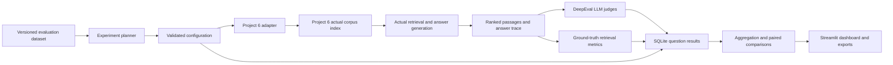

# Architecture

`rag_eval.config`: Pydantic schemas and hashes. `datasets.loader`: bounded CSV/JSONL parsing, immutable content-derived version IDs, missing-annotation diagnostics. `adapters`: abstract base, strict Project 6 HTTP protocol, TEST FIXTURE (not real RAG). `metrics`: DeepEval metric mapping and deterministic retrieval-ground-truth calculations. `experiments.planner`: configuration sweeps without mutation. `experiments.runner`: idempotent, bounded thread pool (UI uses a single matrix execution gate), retries in adapter, cancellation flag, cache key by question/trace/model/evaluator version. `storage.repository`: SQLite WAL/unique `(run_id,question_id)` rows. `evaluation.statistics`: score aggregation and paired bootstrap. `reporting.report`: artifacts generated from saved data. `app.streamlit_app`: eight interactive pages.

## Failure boundaries

Errors in index selection/bridge start make a run `failed`. A failed question is saved with `status=failed`; any selected metric errors/unavailability also makes the full run `incomplete` (all traces remain inspectable). Individual LLM judge errors yield a missing score with metric `status=error` and preserve the question trace. Cancellation stops new dispatches, drains active calls, and yields `cancelled`. Results from non-completed runs remain inspectable but are excluded from completed-only overview/chunking/retriever aggregates. A resume request skips already-persisted question IDs. The project never silently falls back from Project 6 to fixtures.

## Run identity

A run has UUID, dataset checksum/version, full configuration, software snapshot, index fingerprint, start/end timestamps, question-level traces, and error states. Changed configurations create new UUIDs. Query-model-judge cache keys include question+ground truth, real trace, metric/model/threshold/framework version. Unknown latency, token usage, or cost remain null.
